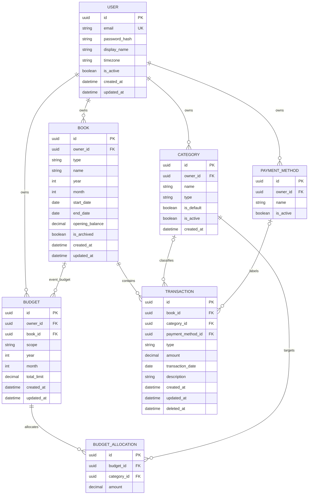

# Khaata — Database Design & ERD

- Document: KH-DBD-001
- Version: 1.0 (approved architecture baseline)
- Date: 2026-10-27
- Database: PostgreSQL

## 1. Conventions
All IDs are UUID primary keys; FKs use UUID. Money uses `NUMERIC(14,2)` / Django `DecimalField(max_digits=14, decimal_places=2)` and JSON decimal strings. Amounts must have no more than 2 fractional digits. Timestamps use `timestamptz`; transaction dates use `date`. Use a custom user model before first migration. All tables are Django-managed; names below are conceptual table names.

## 2. V1 ERD

Nullable references: transaction category/payment method, and budget book. `year`/`month` are nullable except for MONTHLY books or MONTHLY_OVERALL budgets. This ERD is V1 only; sharing tables are deferred.

## 3. Tables and columns

### USER

| Column | Attributes |
| :--- | :--- |
| `id` | UUID PK |
| `email` | varchar(254) not null unique (normalize email; enforce case-insensitive uniqueness via normalized value or functional unique index) |
| `password` | varchar(128) not null (Django hash) |
| `display_name` | varchar(120) |
| `timezone` | varchar(64) not null default 'Asia/Kolkata' |
| `is_active` | boolean not null default true |
| `created_at` | timestamptz not null |
| `updated_at` | timestamptz not null |

### BOOK

| Column | Attributes |
| :--- | :--- |
| `id` | UUID PK |
| `owner_id` | UUID not null FK USER |
| `type` | varchar(20) not null enum MONTHLY/EVENT/GENERAL |
| `name` | varchar(150) not null |
| `description` | text |
| `year` | smallint null |
| `month` | smallint null |
| `start_date` | date null |
| `end_date` | date null |
| `opening_balance` | numeric(14,2) not null default 0 |
| `is_archived` | boolean not null default false |
| `created_at` / `updated_at` | timestamptz not null |

**Constraints & Business Rules:**
* `(type='MONTHLY' AND year IS NOT NULL AND month BETWEEN 1 AND 12) OR (type IN ('EVENT','GENERAL') AND year IS NULL AND month IS NULL)`
* Partial unique `(owner_id,year,month) WHERE type='MONTHLY'`
* `end_date IS NULL OR start_date IS NULL OR end_date>=start_date`
* Prevent manual type changes to/from MONTHLY
* Monthly books are not manually deleted

### CATEGORY

| Column | Attributes |
| :--- | :--- |
| `id` | UUID PK |
| `owner_id` | UUID not null FK USER |
| `name` | varchar(80) not null |
| `type` | varchar(10) not null enum INCOME/EXPENSE |
| `is_default` | boolean not null default false |
| `is_active` | boolean not null default true |
| `created_at` | timestamptz not null |

**Constraints & Business Rules:**
* Unique case-insensitive `(owner_id, type, lower(name))`
* Seed per-user categories
* Deactivate referenced categories instead of deleting

### PAYMENT_METHOD

| Column | Attributes |
| :--- | :--- |
| `id` | UUID PK |
| `owner_id` | UUID not null FK USER |
| `name` | varchar(60) not null |
| `is_active` | boolean not null default true |

**Constraints & Business Rules:**
* Unique case-insensitive `(owner_id,lower(name))`
* Seed Cash, UPI, Bank Transfer, Debit Card, Credit Card, Other
* Descriptive labels only

### TRANSACTION

| Column | Attributes |
| :--- | :--- |
| `id` | UUID PK |
| `book_id` | UUID not null FK BOOK |
| `category_id` | UUID null FK CATEGORY ON DELETE PROTECT |
| `payment_method_id` | UUID null FK PAYMENT_METHOD ON DELETE PROTECT |
| `type` | varchar(10) not null enum INCOME/EXPENSE |
| `amount` | numeric(14,2) not null CHECK(amount>0) |
| `transaction_date` | date not null |
| `description` | varchar(500) null |
| `created_at` / `updated_at` | timestamptz not null |
| `deleted_at` | timestamptz null |

**Constraints & Business Rules:**
* Book FK uses PROTECT; do not hard-delete financial books
* Category/payment-method ownership and category type compatibility are application-level validations (cross-table)
* Monthly book/date match enforced in domain service
* Soft-delete via `deleted_at`, with active-only default query manager and unrestricted audit/admin manager

### BUDGET

| Column | Attributes |
| :--- | :--- |
| `id` | UUID PK |
| `owner_id` | UUID not null FK USER |
| `scope` | varchar(20) not null enum MONTHLY_OVERALL/EVENT |
| `book_id` | UUID null FK BOOK ON DELETE PROTECT |
| `year` | smallint null |
| `month` | smallint null |
| `total_limit` | numeric(14,2) not null CHECK(total_limit>=0) |
| `created_at` / `updated_at` | timestamptz not null |

**Constraints & Business Rules:**
* MONTHLY_OVERALL requires valid year/month and null book_id
* EVENT requires book_id and null year/month
* Partial unique `(owner_id,year,month) WHERE scope='MONTHLY_OVERALL'`
* Partial unique `(book_id) WHERE scope='EVENT'`
* Event budget's book must be type EVENT and owned by budget owner (domain validation)
* A monthly budget can exist without a materialized monthly book

### BUDGET_ALLOCATION

| Column | Attributes |
| :--- | :--- |
| `id` | UUID PK |
| `budget_id` | UUID not null FK BUDGET ON DELETE CASCADE |
| `category_id` | UUID not null FK CATEGORY ON DELETE PROTECT |
| `amount` | numeric(14,2) not null CHECK(amount>=0) |

**Constraints & Business Rules:**
* Unique `(budget_id,category_id)`
* Category must be EXPENSE and owned by budget owner
* Sum allocations <= parent `total_limit` enforced by service with `select_for_update()` on budget row inside `transaction.atomic()`
* All writers must use that service

## 4. Reporting and calculation invariants
- Active transaction predicate: `deleted_at IS NULL`.
- Book income/expense: sum active transactions of corresponding type for a book.
- Combined month income/expense: sum active transactions owned by user across ALL book types with `transaction_date >= first_day AND transaction_date < first_day_next_month`.
- Monthly book-type breakdown: group combined-month active expenses by book.type; sum breakdown = total expense.
- Monthly budget usage: combined-month active EXPENSE sum. Category usage: same query filtered by category_id. Null categories are Uncategorised, included in total only.
- Event budget usage: active EXPENSE sum for event book regardless of date. Event category usage: same filtered by category_id.
- Remaining = limit - spent (negative allowed). Utilization = spent / limit * 100 if limit > 0; for zero limit use explicit NOT_ALLOCATED or UNBUDGETED_SPENDING state, never divide by zero.
- Net cash flow = income - expenses; optional book closing balance = opening_balance + income - expenses. Do not call net cash flow accounting profit.
- Aggregates are computed from source rows, not stored counters. No duplicate transactions across books.

## 5. Indexes
- BOOK: partial unique monthly key, index `(owner_id,type,is_archived)`.
- TRANSACTION: index `(book_id,transaction_date)` conditioned on `deleted_at IS NULL`; index `(transaction_date)` conditioned on active for cross-book monthly report, review EXPLAIN after sample data.
- BUDGET: both partial unique keys.
- CATEGORY/PAYMENT_METHOD: functional uniqueness indexes.
Avoid speculative indexes until query profiling.

## 6. Integrity and concurrency
- Monthly ensure: atomic get-or-create plus partial unique constraint, handle racing insert safely.
- Budget allocation replace: lock parent budget row, validate all rows, replace allocations in one DB transaction.
- Moving a monthly transaction between months: atomically ensure target book, validate owner/archive, and update transaction.
- Soft deletion is idempotent; deletion must not destroy history.
- Editing historical transaction changes historical month aggregates immediately.
- All API list/detail/query paths must scope through authenticated owner; avoid leaking cross-user IDs.

## 7. Test matrix
1. Concurrent monthly ensure creates exactly one book.
2. Leap-year February and year-end date boundaries.
3. Event spanning two months contributes correctly to each month's overall report.
4. Archived event transactions remain in historical reports.
5. Change category/type/date/book and recalculate totals without double count.
6. Soft delete excludes record from all active totals.
7. Zero-budget and >100% utilization cases.
8. Allocation sum exceeds total: reject and roll back.
9. Cross-user category/payment-method/book references: reject.
10. Decimal 0.01 precision and very large amounts.
11. Null category included in total, excluded from category-specific allocation.
12. Income excluded from budget utilization; opening balance excluded from income.

## 8. V2 extension (NOT V1 migrations)
Plan BOOK_MEMBER, SHARED_EXPENSE, EXPENSE_SHARE, SETTLEMENT. Revisit owner/reporting semantics and unpaid shared balances in a separate V2 ADR. Do not add these tables now.
