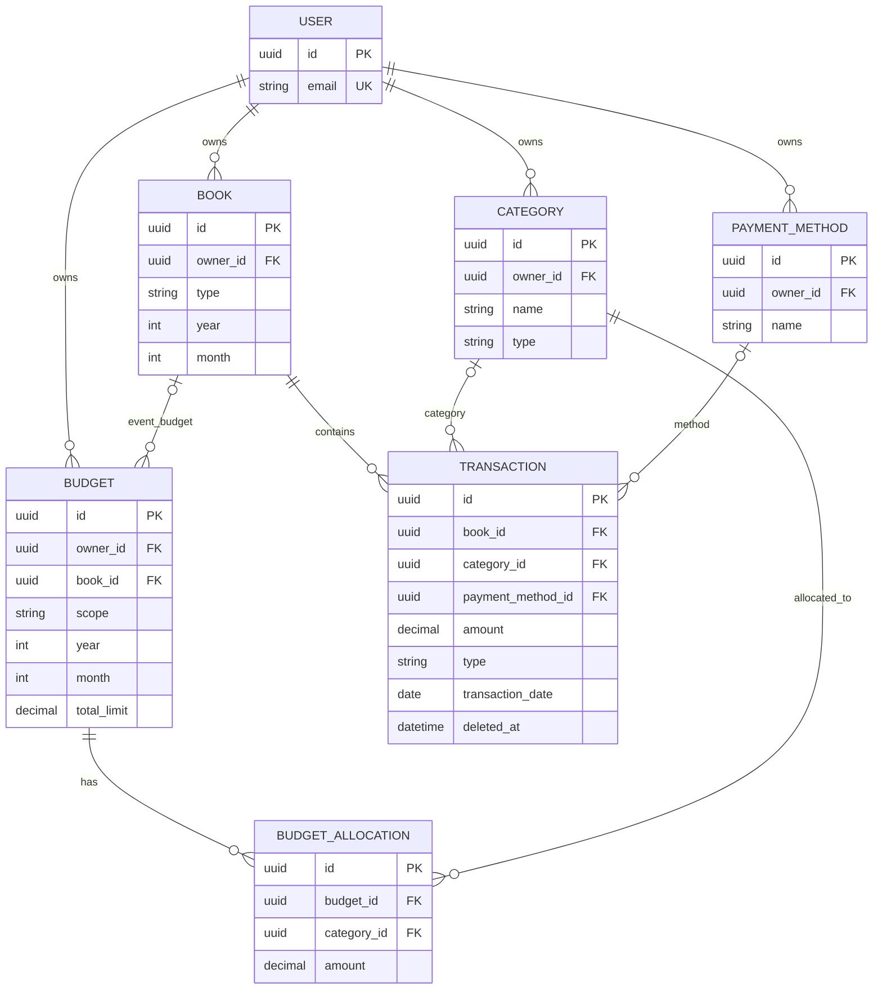

# Khaata — Standalone V1 ERD

Canonical field definitions, constraints, and business invariants are in [DATABASE_DESIGN.md](DATABASE_DESIGN.md). This diagram is conceptual and omits some columns for readability.

