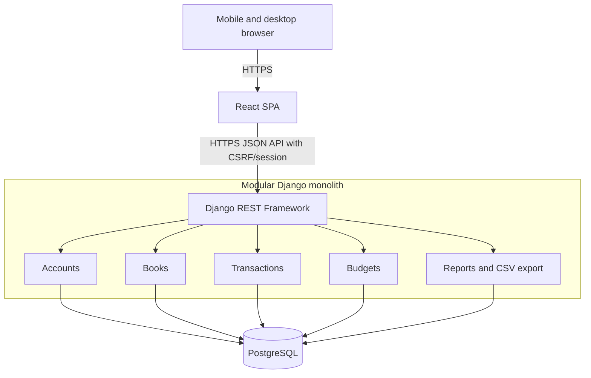

# Khaata — System Architecture Document

- Document: KH-SAD-001
- Version: 1.0 (approved architecture baseline)
- Date: 2026-10-27
- Source: Approved Khaata SRS v1.0 and combined dashboard decision
- Scope: V1 MVP; V2 extension points explicitly marked

## 1. Product boundary
Khaata is a mobile-first personal finance and event expense web app. Each authenticated user owns monthly, event, and general books. Monthly books are created on demand. Event and general books are created manually. V1 is single-user/private; group sharing and settlements are V2.

## 2. Stack
- Frontend: React, TypeScript, Vite, React Router, Tailwind CSS, TanStack Query, React Hook Form, Zod, Recharts.
- Backend: Python, Django, Django REST Framework, Django ORM, PostgreSQL.
- Tests: pytest/pytest-django, Vitest, React Testing Library.
- Dev: Docker Compose optional for PostgreSQL, .env.example, GitHub Actions.
- Deployment candidate: static frontend on Cloudflare Pages; Django on a Python host; managed PostgreSQL. Verify live provider limits, database backup policy, and auth cookie compatibility before selection.

## 3. Architecture

## 4. Modules and boundaries
- `accounts`: custom UUID user model, email identity, auth, timezone.
- `books`: book lifecycle, auto monthly creation, archive/restore.
- `transactions`: income/expense CRUD, categories, payment method labels, soft delete.
- `budgets`: overall monthly and event budgets, atomic allocation updates, overspending calculations.
- `reports`: read-only aggregated dashboard and book reports, CSV export.
- `common`: shared validation, time/decimal helpers, errors.
- `sharing`: **not implemented in V1**; reserved for V2.

Use DRF views for transport and auth checks, serializers for input validation, domain services for cross-model business rules, and ORM query services for reports. Do not introduce microservices, queues, or mutable summary balances in V1.

## 5. Domain semantics
- Each transaction belongs to exactly one book; only INCOME and EXPENSE in V1.
- Book summary = transactions directly inside that book.
- Combined month summary = active transactions across *all* books owned by the user whose transaction date falls within the selected month. Include monthly, event, and general books, regardless of book archival status. Count each transaction exactly once.
- Book-type breakdown partitions combined-month expenses by the transaction's parent book type; sum of breakdown equals combined total.
- Monthly overall budget evaluates all expense transactions within that calendar month across all book types. Event budget evaluates expenses within that event book (even across months). The same expense may contribute to two **distinct budget views** without duplicating the transaction or combined report total.
- Uncategorised expenses consume the overall budget and appear as 'Uncategorised'; they do not consume a category allocation.
- Spending is permitted above budget; show negative remaining amount, overspend magnitude, and utilization >100%.
- Opening balance is not income. Monthly opening balances do not automatically carry forward in V1. Payment methods are descriptive labels, not reconciled accounts. Transfers, credit-card repayment semantics, and accounting profit/loss are out of scope.

## 6. Transaction workflows
1. Authenticate user and determine owned book.
2. Validate positive 2-decimal amount, date, category type/ownership, and payment-method ownership.
3. For MONTHLY book, require date within its year/month. If an existing monthly transaction is edited to a different month, atomically get/create target month book and move it; reject a move to an archived target. Event/general transactions may span months.
4. Save or soft-delete in an atomic operation as appropriate.
5. Derive updated reports from active records; no cached balance to maintain.

## 7. Monthly book creation
`POST /api/v1/books/monthly/{year}/{month}/ensure/` idempotently creates or retrieves the month book. Database partial unique constraint on (owner, year, month) for MONTHLY protects against concurrent creation. Implement transaction-safe get-or-create with integrity-error retry/read. GET endpoints must be read-only. A new user may have no monthly book until first access/entry.

## 8. API surface (draft contracts; final API spec is a later deliverable)
- Auth: POST `/api/v1/auth/register/`, `/login/`, `/logout/`; GET `/me/`.
- Books: GET/POST `/api/v1/books/`; POST `/books/monthly/{year}/{month}/ensure/`; GET/PATCH `/books/{id}/`; POST `/books/{id}/archive/` and `/restore/`.
- Transactions: GET/POST `/api/v1/transactions/`; GET/PATCH/DELETE `/transactions/{id}/`.
- Categories and payment methods: GET/POST list, PATCH item, deactivate instead of hard-delete when referenced.
- Budgets: GET/POST `/api/v1/budgets/`; GET/PATCH `/budgets/{id}/`; PUT `/budgets/{id}/allocations/` for atomic full replacement.
- Reports: GET `/api/v1/reports/monthly/?year=YYYY&month=MM`, `/reports/books/{id}/`, `/reports/budget-utilization/`.
- CSV: GET `/api/v1/exports/transactions.csv` with owned-book/date/type filters.
- JSON money amounts are strings. List responses are paginated. Consistent error payloads. Cross-user objects resolve as 404.

## 9. Auth and security
Use Django server-side session auth with HttpOnly Secure SameSite cookies and CSRF protection. Prefer same-site custom domains or a reverse-proxied API path; **do not assume cookie sessions work across unrelated free-host domains**. Deployment requires browser-level verification of login, CSRF, and logout. Apply object-level ownership filters and validate foreign-key ownership in every write path. Add login throttling, safe password hashing, HTTPS, secret management, CORS allowlist, no sensitive request logging, and secure backups. No financial records in analytics telemetry.

## 10. Non-functional requirements
- Target typical API processing <500 ms under light load, excluding free-tier cold starts.
- Mobile-first and keyboard-accessible forms; user-friendly loading/empty/error states.
- Transaction and budget changes covered by tests for rounding, date boundaries, permissions, concurrent monthly creation, and recalculation.
- Store timestamps in UTC; interpret month/date boundaries in user-configured timezone (initially Asia/Kolkata). `transaction_date` is a DATE, not a timestamp.
- Exports and a tested database backup/recovery procedure before storing real data. CSV alone is not a full relational database backup.

## 11. Release boundaries
V1: private books, transactions, budgets, combined reports, search, CSV, deployment. V2: book members, split expenses, settlements, access roles. V3: PWA/offline sync, recurring entries, attachments, notifications.

## 12. Open implementation checks
- Select and test hosting/domain topology for session cookies and CSRF.
- Define detailed error schema, pagination and sort fields in API spec.
- Decide backup mechanism and test restoration on production-like database.
- Confirm UX policy for changing transaction book and transaction dates.
