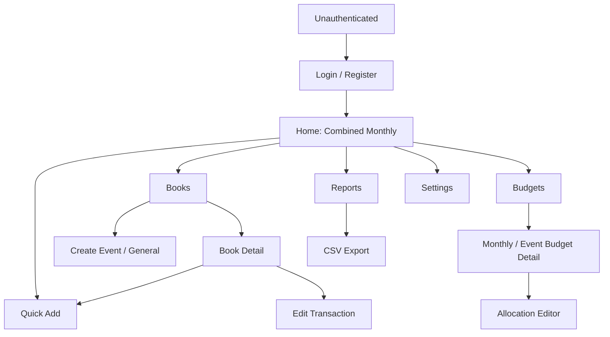

# Khaata — Navigation Map and User Flows (KH-UX-002)

## Flow A: First login and first monthly expense
1. Register or login. Land on Home for user's current month.
2. Empty state offers Add expense and Set budget.
3. Tap Add. Default current-month book: ensure it via POST only when needed.
4. Enter amount and select Expense; date defaults to today. Optional fields available.
5. Submit; backend validates ownership and month. On success navigate to prior context; Home refetches monthly combined totals and budget. On failure keep form state.

## Flow B: Create event and track an expense
1. Books > Create book > Event; enter name (required), optional dates and description.
2. Open event detail; tap Add; book preselected.
3. Save expense dated in chosen month.
4. Event book shows its own total; Home for same calendar month shows the event expense exactly once and labels it under Events; any event budget and monthly budget both update independently.

## Flow C: Plan and audit monthly budget
1. Budgets > choose month > Set overall limit.
2. Add category allocations; display sum and unallocated amount live; reject allocation sum exceeding limit.
3. Save; show category progress and remaining.
4. When expense causes overspend, show warning but allow entry; category and overall warnings are independent.

## Flow D: Search, edit, and delete
1. Books search by name; open a book; filter entries by date/category/type/method and text.
2. Open transaction edit; change amount/category/date; if date changes monthly period, explain move to new monthly book.
3. Save and refresh both affected months and books. For delete, confirm then soft-delete and refetch; reports no longer count it.

## Flow E: Report and export
1. Reports > select month or filters.
2. Show combined total and monthly/event/general breakdown by transaction date; archived book expenses included.
3. Export CSV with same filters. Show download failure and retry if request fails.

## Flow F: Archived book
1. Open event/general book > Archive confirmation.
2. Archived book stays searchable via archived filter; read-only banner; reports retain historical amounts.
3. Restore book to permit edits. Monthly books cannot be archived.

## Navigation state
Use URL query params for selected month, search, and filters when practical. Back returns to the prior book/list without resetting context. Authenticated deep links validate ownership server-side; inaccessible resources show generic Not Found.
